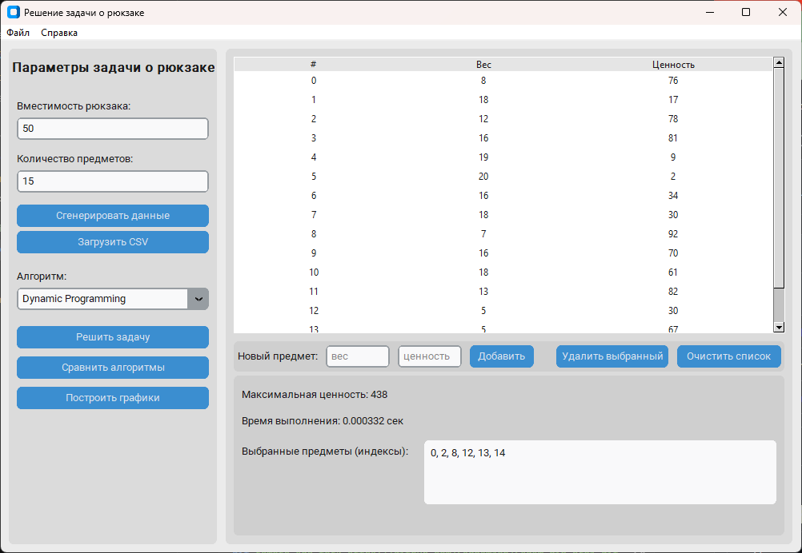
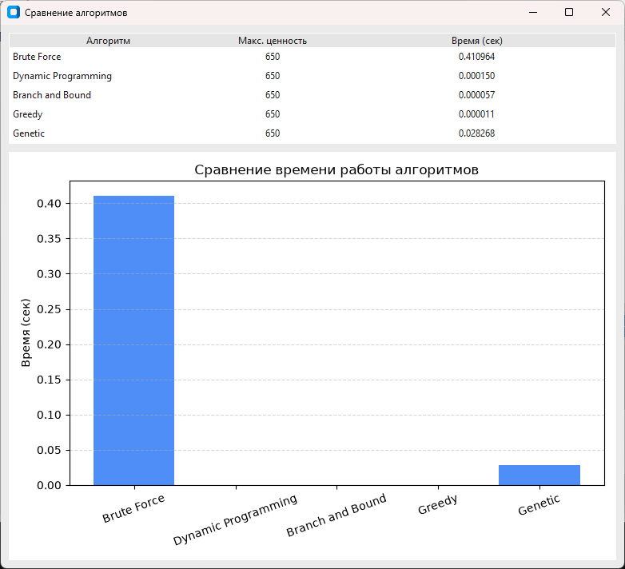
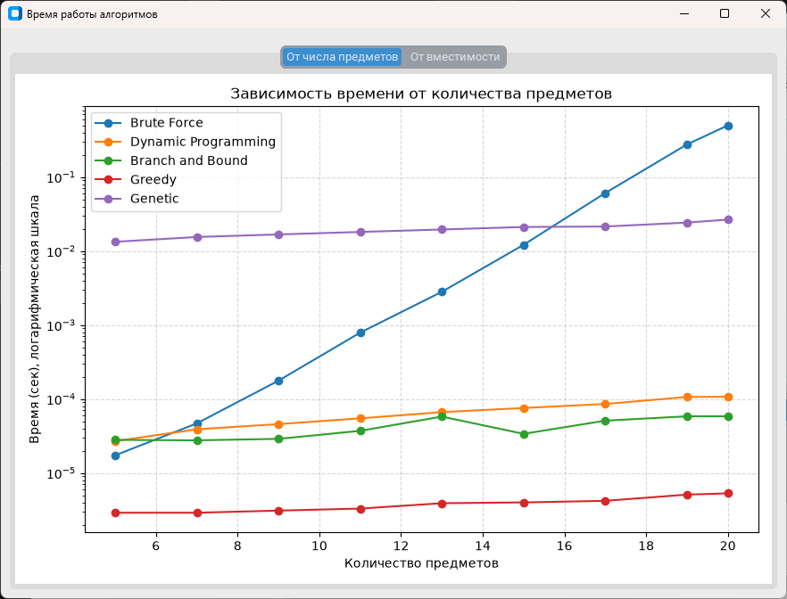
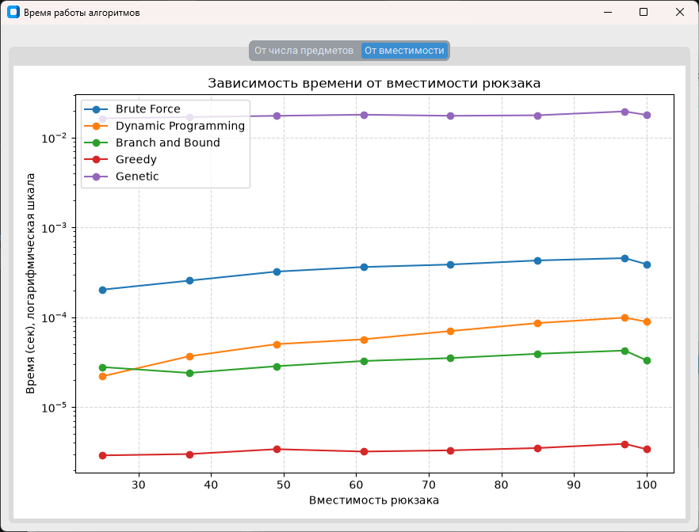

# Knapsack App

Приложение для наглядного сравнения алгоритмов решения 0/1‑задачи о рюкзаке.  
Графический интерфейс реализован на `customtkinter`, для визуализации производительности используются графики на базе `matplotlib`.

## Скриншоты

**Главное окно: данные, выбор алгоритма и результат**



**Сравнение всех пяти алгоритмов на одних данных (20 предметов)**



**Зависимость времени работы от числа предметов и от вместимости**





## Возможности

- **Данные**:
  - случайная генерация набора предметов с заданным количеством (до 5000);
  - ручное добавление и удаление предметов;
  - загрузка из CSV (см. формат ниже);
  - задание вместимости рюкзака.
- **Алгоритмы**:
  - Brute Force (полный перебор, не более 22 предметов — время растёт как 2^n);
  - Dynamic Programming (динамическое программирование);
  - Branch and Bound (метод ветвей и границ, best-first на куче);
  - Greedy (жадный алгоритм по ценности на единицу веса);
  - Genetic (генетический алгоритм с допустимой начальной популяцией, починкой потомков и элитизмом; результат не хуже жадного).
- **Сравнение алгоритмов**:
  - таблица с максимальной ценностью и временем работы каждого алгоритма;
  - диаграмма времени работы;
  - графики зависимости времени работы от числа предметов и от вместимости;
  - ось времени логарифмическая: алгоритмы отличаются на порядки, и на линейной шкале быстрые методы сливались бы с нулём.
- Вычисления выполняются в фоновом потоке, окно не зависает.

## Требования

- Python 3.10+ (проект проверялся на 3.12);
- зависимости из `knapsack_app/requirements.txt`: `customtkinter`, `matplotlib`, `numpy`;
- для тестов дополнительно `pytest` (`knapsack_app/requirements-dev.txt`).

## Установка

```bash
git clone https://github.com/Saddamjon/knapsack-algorithms.git
cd knapsack-algorithms

python -m venv .venv

# Windows (PowerShell / CMD)
.venv\Scripts\activate
# macOS / Linux (bash/zsh)
source .venv/bin/activate

pip install -r knapsack_app/requirements-dev.txt
```

## Запуск

```bash
python knapsack_app/main.py
```

Порядок работы: введите вместимость и количество предметов, нажмите «Сгенерировать данные» (или загрузите CSV), выберите алгоритм и нажмите «Решить задачу». «Сравнить алгоритмы» запускает все пять на одних данных, «Построить графики» строит зависимость времени от числа предметов и от вместимости.

## Формат CSV

- два столбца: вес (целое > 0) и ценность (целое ≥ 0);
- разделитель: запятая, точка с запятой или табуляция;
- кодировка: UTF-8 (с BOM или без) или Windows-1251;
- первая строка может быть заголовком; пустые и некорректные строки пропускаются.

Пример: [`knapsack_app/example.csv`](knapsack_app/example.csv).

## Тесты

```bash
python -m pytest knapsack_app
```

Тесты проверяют корректность алгоритмов (в том числе сверку точных методов с полным перебором на случайных данных), загрузку CSV в разных форматах, диапазоны для графиков и базовую работу интерфейса.

## Структура

```
knapsack_app/
├── main.py          # точка входа
├── algorithms/      # пять алгоритмов решения
├── gui/             # окно приложения (customtkinter)
├── utils/           # генерация данных, замеры времени, графики
└── tests/           # pytest
```
